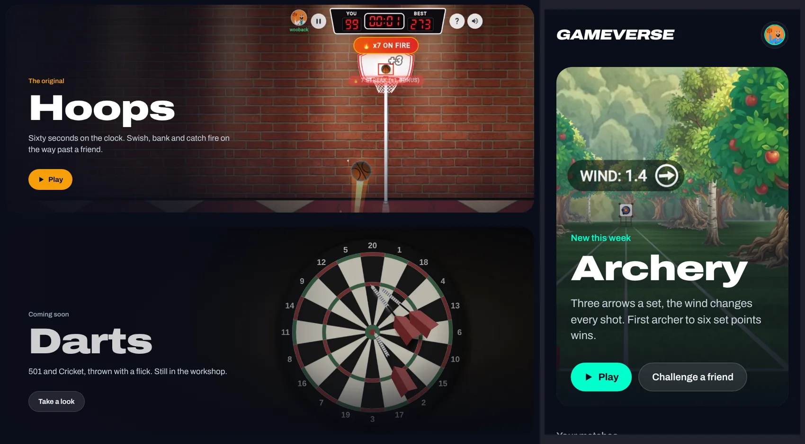
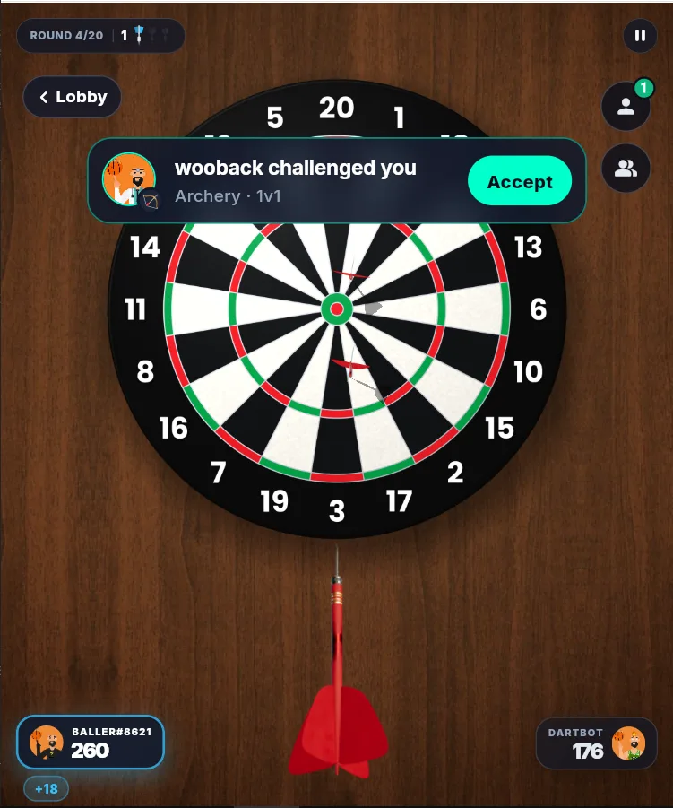
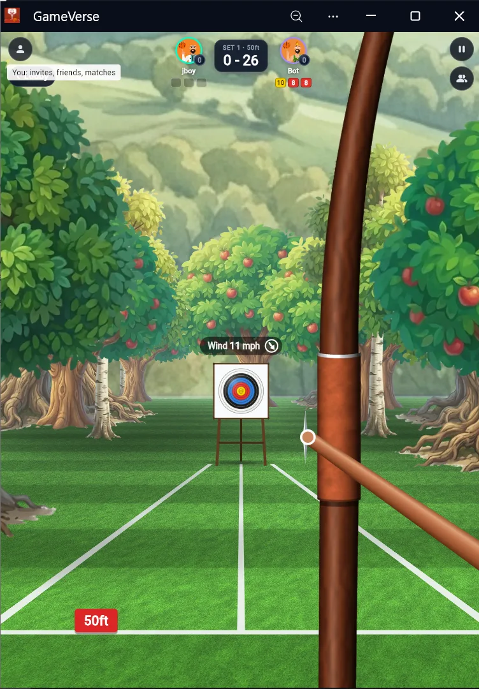

<div align="center">

# GameVerse

**Free 1v1 arcade games you can play with anyone, on any phone. No app needed.**

Hoops · Darts · Archery

[**Play now → dunkverse.web.app**](https://dunkverse.web.app)


</div>

---

## Why

iMessage games like GamePigeon only work between iPhones. GameVerse brings the same quick 1v1 games to the browser, so an Android player and an iPhone player can challenge each other from a link, with nothing to install.

## Games

| | Game | How it plays |
|---|---|---|
| 🏀 | **Hoops** | Sixty seconds on the clock. Flick to shoot, swish and bank for bonus points, and catch fire on a streak. In 1v1 you take turns over 2–4 rounds; the highest total wins. |
| 🎯 | **Darts** | Flick the dart at a full 3D board. 301 against a friend or the bot, with real doubles, trebles and checkouts. |
| 🏹 | **Archery** | Sets of three arrows, with wind that changes every shot. Win a set for 2 set points; first to 6 wins. |

Every game has a solo mode against a bot and a 1v1 online mode.

<p align="center">
  
</p>

<p align="center">
  
  
</p>

## Features

- **Play a friend:** share a 6-character match code, or challenge someone from your friends list.
- **Turn-based online matches** that sync through Firestore, so you can take your turn and come back later.
- **Challenges in game:** invites appear as a banner while you play, with one-tap Accept.
- **Friends and head to head:** add opponents by name or tag and see your all-time record against each one.
- **Match history:** every finished match is kept, with a results sheet for each game.
- **Match chat** in every online match.
- **Sound and music** with separate volume controls, plus a theme track for each game.

## How it's built

| Layer | Tech |
|---|---|
| App | Flutter Web (CanvasKit renderer), targeting iOS Safari and Android Chrome |
| Game engine | [Flame](https://flame-engine.org) + [Forge2D](https://pub.dev/packages/forge2d) (Box2D) |
| Audio | [flutter_soloud](https://pub.dev/packages/flutter_soloud) (C++ mixer compiled to WebAssembly) |
| State | Riverpod (`hooks_riverpod`) + `flutter_hooks` |
| Routing | `go_router` |
| Backend | Firebase Auth, Cloud Firestore, Firebase Hosting |

### 2.5D physics

Flame is a 2D engine, so each game simulates the ball, dart or arrow in **3D** (x, y and depth) and projects it onto the screen every frame:

```
v += g·dt        p += v·dt                    // fixed timestep
screenX = cx + f·x / z
screenY = cy − f·y / z
size    = f·r / z                             // divide by depth
```

- **Arcs:** constant gravity gives a true parabola, and the perspective divide turns it into a deep arc into the screen.
- **Bounces:** rim and backboard hits reflect velocity off the surface normal, `v − 2(v·n)n`, then damp it.
- **Depth sorting:** the hoop is drawn in layers (backboard, back rim, front rim), and the ball's draw order follows its depth, so it drops *through* the net rather than over it.
- **Darts in 3D:** the dart is drawn from an angle-swept sprite sheet. The row is picked from the angle between the dart and the line of sight, so it reads correctly from tail-on to side-on.

### Performance

The target is a steady 60 fps on mid-range phones in the browser:

- No `BackdropFilter` blur over the live game.
- Static scenery (backboard, court) is rasterised once and reused.
- Small HUD widgets, so a score change doesn't rebuild the game screen.
- No allocations in `update()` or `render()`: `Paint`s and rects are cached.
- Device pixel ratio capped at 1.5 on mobile to protect the GPU.
- WebP art, sound effects preloaded in memory, and music streamed on demand.

## Project structure

```
lib/
├── main.dart            # entry point
├── router.dart          # go_router routes
├── game/                # Hoops: Flame game, 3D ball physics, HUD, podium
├── darts/               # Darts: 3D board projection, dart flight, scoring
├── archery/             # Archery: bow, arrow flight, wind, sets
├── lobby/               # game lobby and cards
├── social/              # friends, head to head, profile
├── notifications/       # in-game invites and challenge banners
├── models/              # match and player models
├── providers/           # Riverpod providers
├── services/            # Firebase, audio engine
└── routes/
assets/                  # art (WebP), audio, fonts, avatars
shaders/                 # fragment shaders (basketball, archery ground)
web/                     # index.html and web config
```

## Getting started

**Requirements:** Flutter (stable channel, Dart SDK ≥ 3.13) and a Firebase project.

```bash
git clone <this repo>
cd b_ball
flutter pub get
flutter run -d chrome
```

### Firebase

The app expects Firebase Auth (anonymous sign-in) and Cloud Firestore.

1. Create a Firebase project, then run `flutterfire configure` to generate `lib/firebase_options.dart`.
2. Deploy the rules and indexes from this repo: `firestore.rules` and `firestore.indexes.json`.

### Release build

```bash
flutter build web --release
firebase deploy --only hosting
```

Check the release build on a real phone before deploying.

## Data model

| Path | Contents |
|---|---|
| `/matches/{matchId}` | Match state, players, game type and status. Completed matches are kept permanently for history. |
| `/matches/{matchId}/chat/{messageId}` | Match chat, kept separate from game data. |

## Roadmap

- More 1v1 games, including word games.
- Leaderboards.
- Darts: 501 and Cricket.

See `PROJECT_ROADMAP.md` for details.

---

<div align="center">

Built with Flutter by **Oyindamola Oyesiji**

</div>
